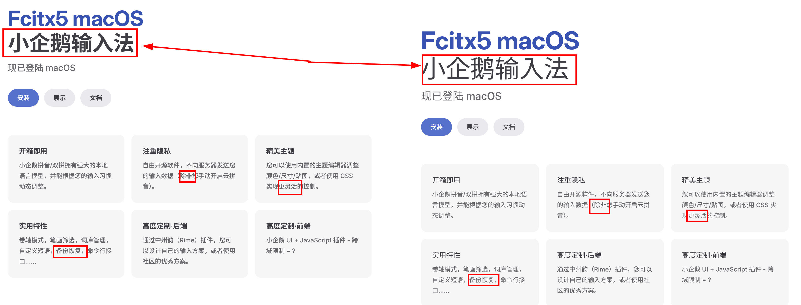

# CJ Font Fallback Fix

[English](README.md) | [简体中文](README.zh-CN.md)

**CJ 指中文和日文，中文包括简体和繁体。** CJ Font Fallback Fix 是一款 Chrome/Chromium 扩展。

Chrome 在 Linux 中，如果网页没有用 `lang` 声明语言，也没有在 CSS 中调用合适的字体，就可能默认使用 Regular 字体。这个插件能让 Linux Chrome 正确调用粗体，并在 `lang="en-US"` 的网站中调用正确的中文字体。这种问题多见于中文网站，日文网站大多会标记 `lang="ja"`。

对于非 Linux 用户，CJ Font Fallback Fix 根据网页语言选择对应的汉字字体，让中文和日文网页呈现符合各自语言习惯的字形。它适合经常浏览不同语言网站、学习日文同时阅读中文内容，以及注重地区字形差异的用户。



图中是 Linux Chrome 打开的中文网页，但网站把语言标成了英文。左侧启用扩展后，浏览器使用了合适的中文字体和粗体；右侧未启用扩展，粗体没有正确显示。

## 字体与检测

扩展支持**简体中文、繁体中文和日文**，会判断网页语言，帮助浏览器使用合适的字体。如果判断不对，可以在工具栏弹窗里为该网站指定语言。

在**设置 → 字体选择**中，可以预览并分别选择各语言的黑体和宋体。宋体选择**与黑体相同**时，两种样式都使用该语言的黑体字体。扩展会从已安装的合适字体中选择默认值，黑体优先使用 Noto Sans CJK，宋体优先使用 Noto Serif CJK。其他默认候选也包含 Windows 和 macOS 常用字体，例如：

| 系统 | 黑体候选 | 宋体候选 |
| --- | --- | --- |
| Windows | 微软雅黑、微软正黑体、Yu Gothic | 宋体、新细明体、Yu Mincho |
| macOS | 苹方、Hiragino Sans | Songti SC／TC、Hiragino Mincho ProN |

实际选择取决于本机已安装的字体；Windows 和 macOS 上安装了合适的 Noto 字体时，也会优先使用它。

### 模式

- **高级模式**默认开启。在需要修正的地方使用你选择的字体，并保留网站的西文字体。默认会动态检查网页后续新增的内容并修正字体，通常无需切换到简单模式。
- **简单模式**修改网页的语言声明，让浏览器决定使用哪款字体。设置页中的字体选择不适用于这个模式。它会检查网页刚打开时出现的内容，之后不再监视后续变化。

### 检测选项

- **信任网页标明的中文或日文**：网站明确标出内容语言时，交给浏览器处理。你手动指定的网站语言优先。
- **保留网站指定的中文、日文字体**：保留网站提供或指定的合适字体，语言不符的字体仍可修正。
- **监视动态页面**：修正后来出现的文字，并在网页内跳转、后退或前进时检查语言。同一地址下展开评论或加载更多内容，通常沿用已有的整页语言。
- **默认中文变体**：文字线索不足以区分简繁时，使用你指定的简体或繁体。

前三项默认开启。**检测明确分隔的中文和日文文本块（实验性）**默认关闭。它可以在自动判断、且中日文内容都足够多的页面中，为分开的段落使用不同字体；手动指定网站语言时不会启用。它可能误判短句或影响网页显示，无法确定的文字会沿用整页语言。

字体排列和检测算法的细节见[架构说明](docs/architecture.md)。

## 网站语言设置

默认情况下，插件会自动判断网页语言。用户也可以通过工具栏弹窗，为某个网站指定使用哪种语言的字体，或禁用该网站的处理。

在**设置 → 管理网站语言设置**中，可以统一管理各网站的语言和应用范围。

### 应用范围

| 选项 | 示例 |
| --- | --- |
| **严格匹配** | `news.example.com` 只影响这个地址，不影响 `example.com` 或 `shop.example.com`。 |
| **包含子域名** | 输入 `news.example.com`，设置会应用于 `example.com` 及其所有子域名。 |

范围按网站名称区分，不针对某一篇文章或某个网址路径。**严格匹配**优先于**包含子域名**，工具栏弹窗中的修改只针对当前网站名称。

界面跟随浏览器语言，支持英文、日文、简体中文和繁体中文；其他语言使用英文。

## 查看运行状态

点击工具栏图标，可以查看网页语言和字体修正是否生效。**HTML lang** 是网站自己标明的语言，可能与检测结果不同。

扩展修正字体，或在简单模式中设置网页语言时，魔导书会打开；没有执行这两种操作时，工具栏和弹窗中的魔导书都会合上。默认情况下，插件会信任网页明确标出的中文或日文 `lang` 标签，并保留网站已使用的合适 CJK 字体（中文、日文字体）。

修正字体时，**已应用字体**、**CSS 干预**和**处理元素**说明扩展使用了哪些字体，以及处理了多少网页元素；未介入时，这些信息会隐藏。简单模式显示**应用的 lang**，即扩展设置的网页语言。这些信息反映扩展的操作，不能证明浏览器最终用哪款字体绘制了每个字。

Chrome 内部页面、Chrome 应用商店等受保护页面无法运行此扩展。

## 安装

1. 解压发布版 ZIP。
2. 打开 `chrome://extensions`，开启**开发者模式**。
3. 点击**加载已解压的扩展程序**，选择解压后的目录。
4. 打开扩展的**设置**，检查或调整字体选择。

从源码构建时，运行 `npm ci` 和 `npm run build`，然后加载生成的 `dist` 目录。

## 开发与限制

源码使用 TypeScript、Vite 和 Manifest V3，运行时代码没有第三方依赖。主要模块和运行流程见[架构说明](docs/architecture.md)；已确定的取舍见[设计决策](docs/decisions.md)；浏览器测试方法见[测试说明](docs/testing.md)。

```sh
npm ci
npm test
npm run test:sites
npm run build
```

`npm test` 运行本地单元测试。`npm run test:sites` 会在真实 Chromium 中运行本地 SPA 样本和若干在线网站测试；完整网站测试需要联网，也可能受网站变化影响。可选的 `npm run test:corpus` 使用 `CJ_FLORES_DIR` 指向本机的 FLORES-200 数据；语料不会提交到仓库，也不会打包进扩展。准备方法和测试边界见[测试说明](docs/testing.md)。`npm run build` 会先检查 TypeScript，再把扩展构建到 `dist`。

扩展无法读取浏览器最终为**每个字形**使用的实际字体，只能根据网页 CSS、字体信息和本机字体可用性作判断。少量共用汉字无法可靠区分地区；实验性混排也不会覆盖所有行内结构。开放式 Shadow DOM 在被发现后可以处理，封闭式 Shadow DOM 无法检查。

## 许可证

源码、原创图标和文档文字采用 [GNU GPLv3](LICENSE)（`GPL-3.0-only`）授权。[效果对比截图](docs/images/bold-chinese-before-after.png)展示了第三方网站，**不在上述授权范围内**；本项目也不授予转载截图中网站内容的权利。

构建生成的 `dist` 只包含扩展运行所需文件及许可证，不包含 README、开发文档或效果对比截图。发布流程会为 ZIP 所对应的源码版本创建标签。
