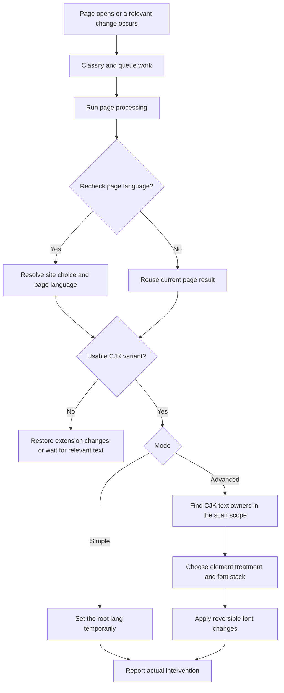
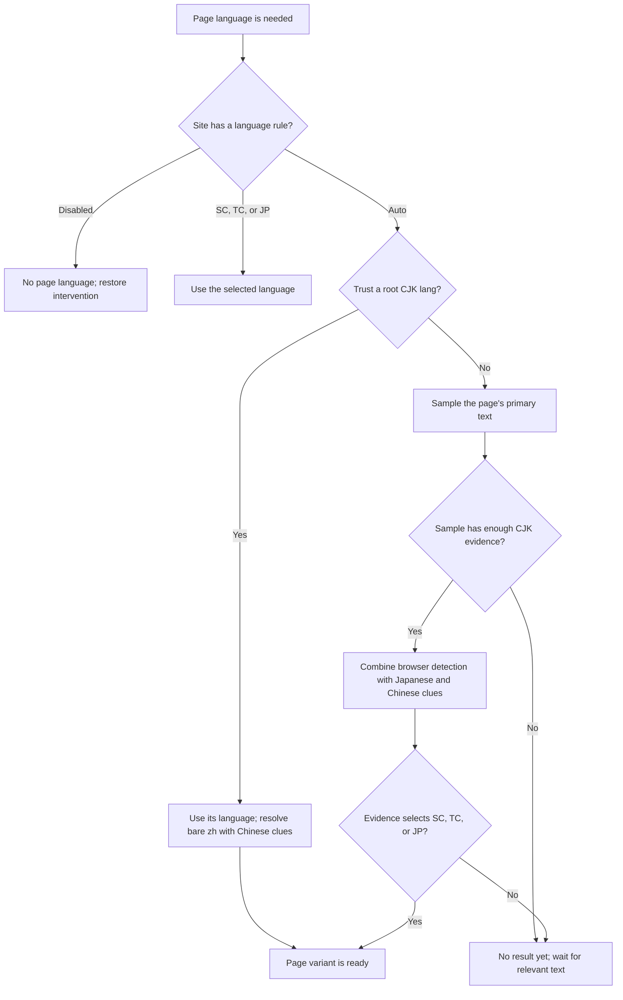
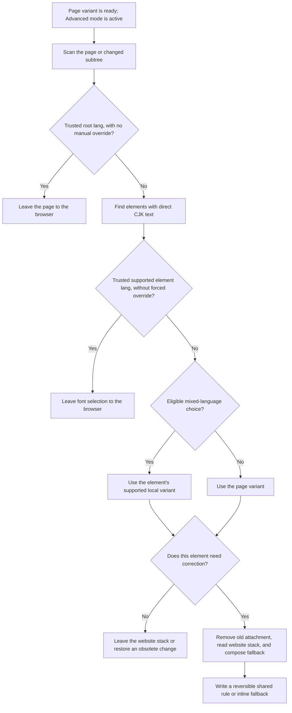
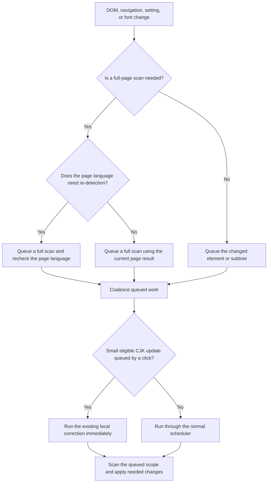

# Architecture

This maps the code as it exists, not proposed features. Read [design decisions](decisions.md) before changing language or font policy, and [testing](testing.md) before interpreting a browser result. The README describes user-visible behavior. Use [code map](code-map.md) to locate functions and [runtime details](runtime-details.md) for focused implementation reference.

## Find the owner

| If you need to change... | Start here |
| --- | --- |
| Content startup, settings reactions, run scheduling, or status messages | `src/entries/content.ts` |
| Toolbar icon state or installation-time font selection | `src/entries/background.ts` |
| Page language and sample selection | `src/page/page-language.ts` |
| Inherited element `lang` behavior | `src/page/element-language.ts` |
| SC/TC clues, Japanese character clues, or local mixed-language evidence | `src/language/chinese-clues.ts`, `src/language/japanese-character-clues.ts`, `src/language/local-evidence.ts` |
| DOM candidates, mutation invalidation, or work coalescing | `src/page/candidate-scan.ts`, `src/page/page-observer.ts`, `src/page/update-queue.ts` |
| Advanced variant precedence and font application | `src/fallback/controller.ts` |
| Experimental wrappers or the Bangumi heading exception | `src/fallback/mixed-language.ts`, `src/fallback/site-rules/bangumi.ts` |
| Font recognition, insertion order, or availability | `src/fonts/font-family.ts`, `src/fonts/font-support.ts`, `src/fonts/unicode-range.ts` |
| Shared CSS, cleanup, or Simple mode | `src/fallback/font-stack-rules.ts`, `src/fallback/managed-styles.ts`, `src/fallback/simple-mode.ts` |
| Defaults, installed-font choices, or hostname overrides | `src/settings/defaults.ts`, `src/settings/font-catalog.ts`, `src/settings/site-overrides.ts` |
| Settings UI, site manager, popup, or localization | `src/options/`, `src/popup/`, `src/shared/i18n.ts`, `_locales/` |
| Bundle names or files copied into `dist` | `scripts/build.mjs`, `manifest.json` |

`src/shared/` contains cross-surface types and small UI helpers, not settings implementation. Put a rule where its reason for changing belongs; do not add a forwarding module merely to make entry points symmetrical. The content entry owns orchestration because it needs settings, observer, detector, and style controller together. The background entry is smaller and directly registers its own listeners.

## Build and runtime surfaces

`manifest.json` is Manifest V3. Vite builds `src/entries/content.ts` into one self-contained IIFE, `dist/content.js`. It builds `src/entries/background.ts` into `dist/background.js`, an ES-module service worker. `src/options/main.ts` and `src/popup/main.ts` are extension-page entries. `scripts/build.mjs` also copies the manifest, icons, locales, and license into `dist`; README files, architecture docs, and screenshots stay in the source repository.

`.github/workflows/release.yml` builds from a GitHub source revision, checks that the package and manifest versions agree, requires a hand-written `docs/releases/release-notes.md`, and packages only `dist` as the Release asset. See [publishing a release](releasing.md) for the maintainer procedure.

The content script runs at `document_start` in matching HTTP(S) frames, including configured blank/origin-fallback frames. Each frame detects and styles its own document. The popup addresses the top-level frame; only that frame reports toolbar icon state. The background worker accepts `setActionState` messages from frame 0 and applies the open-book icon only when intervention is in use. On cross-document navigation, Chromium restores the manifest's closed default; the worker forgets its old per-tab state so the new page's report can repaint it. There is no navigation timer or separate page-status probe. Its in-memory icon state is not durable across worker restarts.

Browser-owned and protected pages may not run content scripts. Their popup shows an unavailable state; there is no page status message to wait for. The UI language comes from extension locales (`_locales/`); English is the fallback. There is no user-chosen UI-language setting.

## Content-script flow

Opening a page starts one content-script run. Relevant DOM, settings, and font changes enter the same flow with either a new language decision or the existing one.

The content entry coordinates the run. `PageObserver` interprets DOM changes; `UpdateQueue` merges full-page, subtree, and direct-element work. `PageLanguageDetector` supplies the page result, while `FallbackController` handles Advanced-mode elements. `ManagedStyles` restores old changes and shares generated CSS rules. Simple mode only sets the root `lang` and restores its original value later.

### How the page language is chosen

The detector uses the same page result until navigation, settings, or a substantial sample change requires another decision. Sampling details and evidence limits are in [runtime details](runtime-details.md#language-sampling).

### Which elements receive font changes

Candidate scanning targets direct text owners, not every ancestor containing CJK somewhere below it. The controller batches style reads and writes; unsupported, already-correct, or protected website stacks remain unchanged. [Design decisions](decisions.md) records the font-preservation rules.

### What happens when a page changes

Stable same-page additions reuse the existing page result and scan only queued scopes. Route changes, relevant language-sample changes, and settings can request a full recheck. Small CJK updates queued by a click may use the same local correction path immediately; other work uses the coalesced scheduler. If automatic detection finds no CJK, the observer waits for relevant text instead of repeatedly scanning ordinary page changes. With dynamic detection off, later DOM changes do not trigger rescans; removal cleanup still runs. Scheduling limits and invalidation rules are in [runtime details](runtime-details.md#startup-and-updates).

The optional mixed-language path remains off by default and applies only to eligible Advanced-mode pages. It can choose a local variant for supported text segments after the page-level gate passes; it does not alter the page result. Its evidence and limits are documented in [runtime details](runtime-details.md#experimental-local-language-decisions) and [design decisions](decisions.md#experimental-mixed-language-detection).

## Settings and UI state

Defaults and font choices live in `src/settings/`; general settings save on change, while site-rule forms require explicit submission. Site overrides are stored in separate exact-hostname and registered-domain maps, not by URL path, and are managed separately. The background worker resolves the registered domain using `publicSuffix` once per document and serializes rule edits across popup and Settings. `settings/site-overrides.ts` resolves exact hostname choices before domain choices. An exact hostname `Auto` choice explicitly bypasses an existing domain rule; without one, the default automatic choice leaves no record. `siteRulesFromStorage()` sanitizes both maps and removes redundant automatic choices for worker writes and manager rendering. Update-time cleanup shares the rule-save queue so it cannot overwrite a concurrent edit. Removing the entry restores inheritance; domain `Auto` deletes its rule. The main **Restore defaults** action does not delete site overrides. An unavailable page has no per-site controls in the popup because its content script cannot receive messages.

Content scripts keep both rule maps current on storage notifications. A notification containing only rule maps schedules work only when the current document's effective choice changes; unrelated rules and domain choices masked by a hostname exception do not trigger rescans. Notifications that also change global settings still follow the normal settings-update lifecycle.

The popup distinguishes the page result from actual intervention: a page may be detected as SC, TC, or JP without any attached font correction, including when no configured regional font can be applied. Intervention rows are hidden in this state. The icon opens only when CSS is attached (or Simple mode applies a root language), not merely because a CJK language was detected.

The popup's header book uses the same actual-intervention condition. It defaults to closed and remains closed when the page status is unavailable.

`options/site-language-settings.ts` owns the grouped manager, global search, ten-rule pages, toolbar creation, inline row editing and deletion, and the animated Manage/Hide control. **Add website** replaces the search toolbar with an inline form; Cancel restores the previous search, and successful creation clears search to reveal the new rule. The toolbar remains present for an empty list. Clicking the pencil replaces only that row with its editor; the website name itself is not an edit action. Draft forms survive Hide and storage updates; row drafts also survive search and pagination. Storage notifications are deferred while row drafts are active so a concurrent update cannot replace an input. The worker moves a rule between the two storage maps in one write and rejects an existing destination; canceling an editor never writes its draft. The visible scope labels are **Exact match** and **Include subdomains**; the storage scopes remain `hostname` and `domain`. Restore defaults remains separate from deleting site rules.

The renderer reconciles groups by language and rows by scope/hostname, leaving unchanged DOM nodes connected. Cached normal rows are limited to displayed pages; draft rows remain available until their editor closes, and removed rules are evicted. Individual deletion collapses only the removed row, or its group when the last matching rule disappears. Rapid delete clicks queue their writes and collapses so they do not interrupt each other or drop a click. Unrelated groups and focused drafts remain active throughout. Only Delete all and Undo animate the entire results region, after storage succeeds.

`ui.css` owns the shared palette and control appearance. Button roles choose internal color values; hover, focus, active, and disabled behavior is defined once. Page selectors own widths and placement, including the popup's full-width Settings action. Foreground and background colors switch together with the theme, while border, shadow, and press effects retain their transitions. Reduced-motion preferences cover search fields and other interactive controls.

## Maintenance rules

- Preserve the website's Latin families, trusted language declarations, and current user text. Do not replace them with a fixed OS-specific stack or a guessed language tag.
- Keep page detection, local evidence, DOM mutation interpretation, and style application in their existing ownership boundaries. A site-specific parser belongs under `fallback/site-rules/`, not in the general language classifier.
- Preserve the remove/read/write order for style work and restoration of wrappers, inline styles, and shared rules.
- Treat language clue lists as evidence, not complete dictionaries or proof that a glyph uses a particular physical font.
- Keep comments in English and explain non-obvious policy or browser constraints rather than restating syntax.
- For browser-visible behavior changes, update the manifest/package version together, rebuild `dist`, and verify the relevant real site. Documentation-only edits do not need a version bump.

See [design decisions](decisions.md) for accepted limits and [testing](testing.md) for commands and browser-test interpretation.
